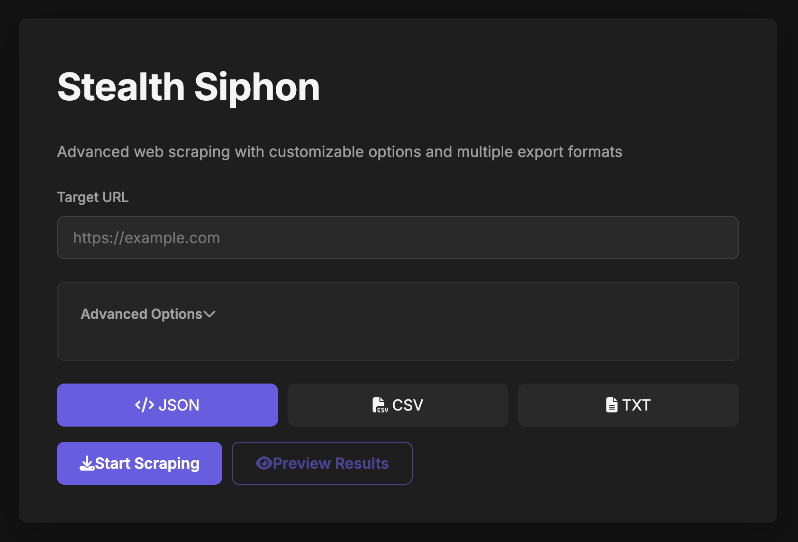

# Stealth Siphon

**Makes the web readable for your AI agents.** Stealth Siphon is a local, self-hosted toolkit that gives an agent clean Markdown instead of raw HTML. It also extracts structured data, crawls sites within set limits, drives a real headless Chrome for logins and multi-step flows, and watches pages for changes. It works with local models through **LM Studio**, **Ollama**, or any OpenAI-compatible server.

You can use it four ways: an **MCP server** (Claude Code, Claude Desktop, LocalClaw, any MCP client), a **REST API**, a **CLI**, or the **web UI**.



## Created by Christopher Bradford

---

## Why give your agent Stealth Siphon?

Agents handle the web badly when left alone with raw HTTP:

| Problem | What Stealth Siphon does |
|---|---|
| **Raw HTML wastes context.** Navigation, scripts, CSS, and tracking markup can make up over 90% of a page. | Returns only the main content as Markdown. Measured on real pages: Wikipedia **11×** smaller, BBC News **23×**, a GitHub repo page **30×**, an MDN doc **75×**. Long pages come back in chunks the agent can page through. |
| **Modern sites need JavaScript.** A plain fetch of a React or Next.js page returns an empty `<div id="root">`. | Auto mode detects JavaScript-rendered pages and bot walls (403/429/503) and switches to a real headless Chrome. |
| **Some tasks are interactive.** Logins, search forms, "load more", and infinite scroll can't be done with a single request. | Persistent browser sessions with a compact page snapshot. The agent clicks and types by element ref (`[e12]`) instead of guessing CSS selectors. |
| **Agents need data, not prose.** | `extract` returns JSON from CSS selectors, or from a JSON Schema filled in by **your local model** (LM Studio, Ollama). No cloud API keys required. |
| **Crawling floods the context.** | Crawls return a one-line summary per page; the agent reads only the pages it needs. |
| **"Tell me when it changes" needs a scheduler.** | `watch_page` re-checks on a schedule and stores unified diffs; the agent asks `get_changes` later. Webhooks are optional. |
| **Agents can be manipulated by pages.** A malicious page can tell your agent to fetch `http://169.254.169.254/` or your router admin page. | Private, local, and cloud-metadata addresses are blocked at every layer. All web content is wrapped as `<untrusted_web_content>` so the model treats it as data. robots.txt is respected by default. |

Everything runs on your machine. Your browsing, your data, and your model stay local.

---

## Quick start

```bash
git clone https://github.com/sunkencity999/stealthsiphon.git
cd stealthsiphon
npm install          # uses your installed Google Chrome; no browser download
npm start            # web UI + REST API + MCP at http://127.0.0.1:4200
npm test             # 52 tests (browser tests run when Chrome is found)
```

Requirements: Node.js 18.17+ and Google Chrome (or Chromium, Edge, or Brave; set `CHROME_PATH` if it isn't found automatically). LM Studio or Ollama is optional, and only needed for schema-based LLM extraction.

---

## Tutorial: connect Stealth Siphon to your agent

### 1. Register the MCP server

**Claude Code** (stdio, simplest; no server needs to be running):

```bash
claude mcp add stealthsiphon -- node /absolute/path/to/stealthsiphon/bin/mcp.js
```

**Or against a running server** (`npm start`), which also keeps scheduled watches running when no agent is open:

```bash
claude mcp add --transport http stealthsiphon http://127.0.0.1:4200/mcp
```

**Claude Desktop, LocalClaw, or any client that reads MCP JSON config:**

```json
{
  "mcpServers": {
    "stealthsiphon": {
      "command": "node",
      "args": ["/absolute/path/to/stealthsiphon/bin/mcp.js"]
    }
  }
}
```

Check it in Claude Code with `/mcp`. You should see `stealthsiphon` with 26 tools.

### 2. (Optional) Turn on local-model extraction

- **LM Studio:** load any chat model, then open the **Developer** tab and start the server (default `http://127.0.0.1:1234`). Stealth Siphon picks up whatever model is currently loaded.
- **Ollama:** run `ollama serve` with at least one model pulled.

Check what it found:

```bash
node bin/siphon.js llm
# lmstudio  http://127.0.0.1:1234  3 model(s)
#     * qwen/qwen3-8b
# ollama    http://127.0.0.1:11434  unavailable (ECONNREFUSED)
# extract would use: lmstudio / qwen/qwen3-8b   (* = loaded)
```

### 3. Just ask

You don't have to name tools. The server ships instructions that tell the agent which tool fits which job. Try:

| You say | What the agent does |
|---|---|
| "Summarize https://example.com/blog/post" | `fetch_page` returns Markdown of the article, roughly 20× fewer tokens than the HTML |
| "What does this React dashboard show? https://app.example.com/status" | `fetch_page` detects a JavaScript app and renders it in Chrome |
| "Get every product name and price from https://shop.example.com/sale as JSON" | `extract` with `list: ".product"` and CSS fields; or a JSON schema filled in by your local model |
| "Read the docs at https://docs.example.com and tell me how auth works" | `crawl` with `include: ["/docs/**"]`, then `get_crawl_page` on the relevant pages only |
| "Log in to the staging site with these test credentials and screenshot the settings page" | `browser_open`, then `browser_type`, `browser_click` and `browser_screenshot` |
| "Keep an eye on https://vendor.example.com/pricing and tell me what changes" | `watch_page` with schedule `daily`; later, `get_changes` returns diffs |
| "Which pages on this site link to the API reference?" | `get_links` with `match: "api"` |

### 4. Handy patterns

- **Long pages:** the response says `truncated; continue with offset=20000`. The agent can call again with that offset, or use `selector` to fetch only the part it needs.
- **Index and listing pages:** set `mainContent: false`. Readability is tuned for articles and can drop link lists.
- **Login-walled content:** use a browser session. Each session has isolated cookies and closes after 10 minutes idle.
- **Noisy monitoring:** give `watch_page` a `selector` (for example `#pricing-table`) so ads and timestamps don't count as changes.
- **robots.txt:** if a site disallows a path, the tool says so with `ROBOTS_DISALLOWED`. Pass `respectRobots: false` only when you have permission.

---

## MCP tools

| Group | Tool | What it does |
|---|---|---|
| Read | `fetch_page` | URL → Markdown (main content), text, HTML, or raw (for example JSON APIs). Auto-renders JavaScript-heavy pages. Paged with `maxChars`/`offset`. Optional metadata (OpenGraph, JSON-LD, canonical). |
| | `get_links` | Links with anchor text: internal, external, or all, filtered by substring |
| | `screenshot` | Viewport, full page, or a single element as an image |
| Extract | `extract` | CSS mode: `fields` (`"h1"`, `"a@href"`, `{selector, attr, all, type}`) plus `list` for repeated items. LLM mode: JSON `schema` plus `instructions`, filled in by LM Studio, Ollama, or an OpenAI-compatible server. |
| Crawl | `crawl` | Crawls a site from a start URL with `maxPages`/`maxDepth` limits, include/exclude globs, and sitemap seeding. Returns per-page summaries. |
| | `crawl_status` · `get_crawl_page` · `cancel_crawl` | Check progress, read one stored page (paged), or stop the crawl |
| Browser | `browser_open` | Opens a persistent, isolated Chrome session and returns a page snapshot with element refs |
| | `browser_navigate` · `browser_click` · `browser_type` · `browser_select` · `browser_press` · `browser_scroll` · `browser_wait` | Drive the session. Target elements by `ref`, `selector`, or visible `text`. |
| | `browser_snapshot` · `browser_read` · `browser_screenshot` · `browser_evaluate` · `browser_close` | Inspect, read as Markdown, capture, run JavaScript, or close |
| Monitor | `watch_page` | Scheduled re-fetch that records diffs, with an optional webhook. Presets: `every 5 minutes` … `hourly`, `daily`, `weekly`, or cron. |
| | `get_changes` · `list_tasks` · `run_task` · `delete_task` | Read diffs and manage tasks |

---

## Local LLM providers

Schema-based extraction (`extract` with `schema`) runs on a model you control.

| Provider | Setup | Notes |
|---|---|---|
| **LM Studio** | Start the server in the Developer tab | Uses the currently loaded model unless `LMSTUDIO_MODEL` is set. Uses structured output (`response_format: json_schema`) and retries without it if a model rejects it. |
| **Ollama** | `ollama serve` | Uses `OLLAMA_MODEL`, or the first installed non-embedding model. Uses Ollama's `format` schema constraint. |
| **OpenAI-compatible** | `OPENAI_COMPAT_URL`, `OPENAI_COMPAT_MODEL`, `OPENAI_COMPAT_API_KEY` | vLLM, llama.cpp `server`, LocalAI, or a hosted API |

With `LLM_PROVIDER=auto` (the default), Stealth Siphon probes the servers and prefers one that already has a model loaded. Agents and the API can override the choice per request with `provider` and `model`. The JSON Schema is included in the prompt as well as in the decoding constraint. In testing with a reasoning model, that took an extraction from 3,151 tokens with wrong values to 108 tokens with correct ones. Reasoning output (`<think>…</think>`) and code fences are stripped before parsing.

---

## CLI

```bash
node bin/siphon.js fetch https://example.com                     # Markdown to stdout
node bin/siphon.js fetch https://example.com --format text --max-chars 2000 --offset 2000
node bin/siphon.js fetch https://spa.example --mode browser --scroll --json
node bin/siphon.js links https://news.ycombinator.com --filter external
node bin/siphon.js extract https://quotes.toscrape.com --list .quote \
     --fields '{"text":".text","author":".author","tags":{"selector":".tag","all":true}}'
node bin/siphon.js extract https://books.toscrape.com/catalogue/a-light-in-the-attic_1000/index.html \
     --schema '{"type":"object","properties":{"title":{"type":"string"},"price_gbp":{"type":"number"}}}' --provider lmstudio
node bin/siphon.js screenshot https://example.com -o shot.png --full-page
node bin/siphon.js crawl https://docs.example.com --max-pages 50 --include "/docs/**" --exclude "**/changelog*"
node bin/siphon.js llm                                           # show available local models
```

The global flag `--no-robots` ignores robots.txt (only with permission). After `npm link`, the CLI is available as `siphon`.

---

## REST API

Every `/api` response is JSON. Errors look like `{ "ok": false, "error": { "code", "message" } }`.

| Method & path | Body / query |
|---|---|
| `GET /api/health` | Browser availability, cache stats, settings |
| `GET /api/llm` | Local LLM providers, their models, and which one would be used |
| `POST /api/fetch` (or `GET ?url=`) | `{url, format, mode, mainContent, selector, maxChars, offset, includeMetadata, includeLinks, waitForSelector, scroll, respectRobots, useCache}` |
| `POST /api/extract` | `{url \| html, fields, list, limit}` or `{url, schema, instructions, provider, model}` |
| `POST /api/links` | `{url, filter, maxLinks}` |
| `POST /api/screenshot` | `{url, fullPage, selector, type, width, height}`; returns base64, or the raw image with `?raw=1` |
| `POST /api/crawl` · `GET /api/crawl/:id` · `GET /api/crawl/:id/page?url=` · `POST /api/crawl/:id/cancel` | The crawl runs asynchronously; poll its status |
| `POST /api/sessions` · `POST /api/sessions/:id/{navigate,click,type,select,press,scroll,wait,snapshot,markdown,html,screenshot,evaluate}` · `DELETE /api/sessions/:id` | Browser sessions |
| `GET/POST /api/tasks` · `GET/PUT/DELETE /api/tasks/:id` · `POST /api/tasks/:id/run[?wait=true]` · `GET /api/tasks/:id/runs` · `GET /api/runs/:id` · `GET /api/changes` | Scheduled tasks, run history, and diffs |
| `POST /mcp` | MCP over Streamable HTTP (stateless) |

The legacy endpoints `/proxy`, `/headless-proxy`, `/export-to-db`, `/api/scrape/*`, and `/api/scheduler/tasks` still work for the web UI.

### Fetch modes

- `auto` (default): plain HTTP first. It upgrades to headless Chrome when the page looks client-rendered (an empty SPA root, or almost no text plus scripts), when a bot wall returns 403/429/503, or when `waitForSelector`/`scroll` is requested.
- `http`: never launches a browser.
- `browser`: always renders in Chrome (with isolated cookies per request, and media/fonts blocked).

---

## Web UI

Open `http://127.0.0.1:4200` for point-and-click scraping, exports to JSON/CSV/TXT/HTML, and database export (SQLite, MongoDB, MySQL). The scheduler page manages recurring tasks, and `/landing.html` has the feature overview and tutorial.

---

## Scheduler & change monitoring

Each run is written to `data/results/<taskId>/`, hashed, and diffed against the previous successful run. Runs are stored in SQLite as `status`, `changed`, `addedLines`/`removedLines`, and a unified diff. With `webhookUrl` and `notifyOn: change | always | never`, the server POSTs `{event, task, run, diff}`.

Only one process runs cron jobs at a time: the web server or a stdio MCP process, coordinated through `data/scheduler.lock`. That process re-reads tasks every 30 seconds, so a watch created from any client gets scheduled. Task JSON files from v1 (`scheduled_tasks/`) are imported automatically.

---

## Security model

Assume an agent may be reading hostile pages, and plan accordingly.

- **SSRF protection.** Localhost, RFC1918, link-local/cloud-metadata (`169.254.169.254`), CGNAT, IPv6 ULA/link-local, and encoded forms such as `2130706433` are blocked. The check runs when the URL is parsed, again after DNS resolution, again at socket connect time (which defeats DNS rebinding), on every redirect hop, and on every request made by browser pages. Set `ALLOW_PRIVATE_NETWORKS=true` to opt out.
- **Prompt-injection hygiene.** Web content is wrapped in `<untrusted_web_content>` tags that pages cannot close early. The LLM extraction prompt tells the model to ignore instructions in the page.
- **Binds to `127.0.0.1` by default.** The server rejects foreign `Host` headers (DNS rebinding) and cross-origin browser requests unless the origin is listed in `CORS_ORIGINS`.
- **Optional API key** (`STEALTHSIPHON_API_KEY`) for `/api`, `/mcp`, and the legacy endpoints.
- **Only `public/` and `image/` are served.** The database, task configs, and source code are never exposed, and errors never include stack traces.
- **robots.txt is honored by default**, including `Crawl-delay`. Disallowed links are never queued during crawls. You can override this per request with `respectRobots: false`.
- **Per-host concurrency and rate limiting** protect target sites and your IP.

Configuration lives in `.env`; [`.env.example`](.env.example) documents every setting.

---

## Project layout

```
src/
  config.js           env-driven settings (+ .env loader)
  server.js           express app: UI, /api, /mcp, guards
  api.js              REST routes + legacy routes + error handler
  mcp.js              MCP tool definitions
  scheduler.js        cron tasks, run history, diffs, webhooks
  exporters.js        SQLite/Mongo/MySQL export for the UI
  core/
    safety.js         SSRF protection
    http.js           safe HTTP client
    browser.js        puppeteer-core: render, screenshots, sessions
    scrape.js         fetch orchestration (auto mode, cache, formats)
    content.js        Markdown/text/metadata/links/paging
    extract.js        CSS + LLM extraction
    llm.js            LM Studio / Ollama / OpenAI-compatible providers
    crawl.js          bounded concurrent crawler
    robots.js         robots.txt + sitemaps
    limiter.js        per-host politeness
    cache.js          TTL LRU
    store.js          SQLite (better-sqlite3)
bin/                  siphon CLI, stdio MCP server
public/               web UI and landing page
test/                 node:test suites with a local fixture site and LLM stubs
```

---

## Recent Updates

### Version 2.1.0 (November 2026)

- **LM Studio support** for LLM extraction, plus generic OpenAI-compatible servers. Auto-detects running providers and loaded models.
- The JSON Schema is now included in the extraction prompt (big accuracy and speed win with constrained decoding)
- `siphon llm` CLI command and `GET /api/llm`
- `.env` parser handles inline comments
- New landing page with feature overview and agent tutorial

### Version 2.0.0 (November 2026)

- MCP server (stdio + Streamable HTTP) with 26 agent-oriented tools
- Real headless Chrome rendering, screenshots, and interactive browser sessions
- Clean Markdown output with metadata, link inventory, and pagination
- Structured extraction (CSS fields/lists or JSON Schema)
- Concurrent, rate-limited crawler that respects robots.txt, with persisted results
- Scheduler rewrite: SQLite run history, diffs, webhooks, single-leader locking
- CLI, security hardening (SSRF, Host/Origin guards, API key), dependency cleanup

### Version 1.x (April 2025)

- Deep link following, scheduler UI, database export, headless fallback, port 4200

## License

MIT
